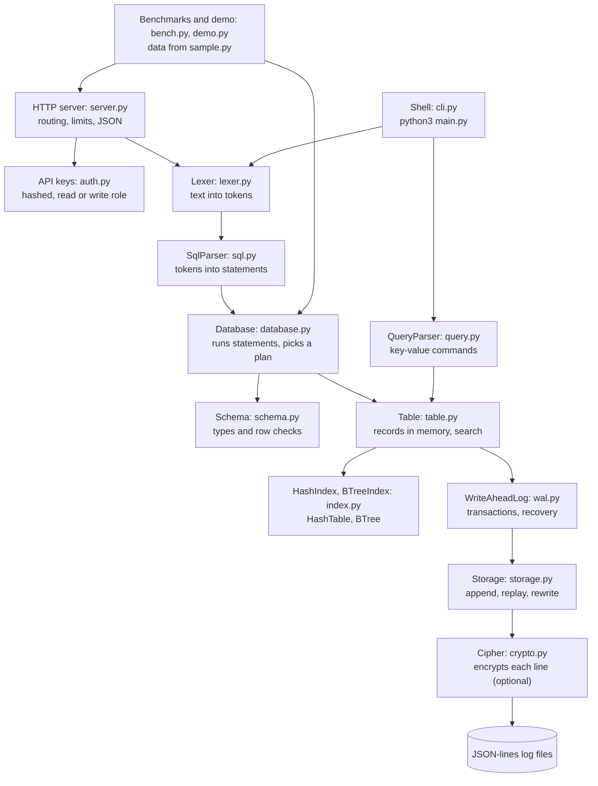
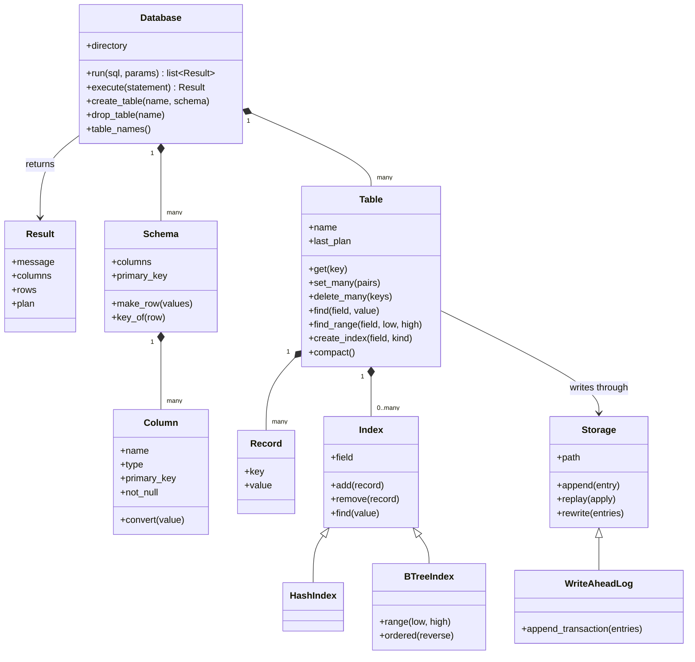
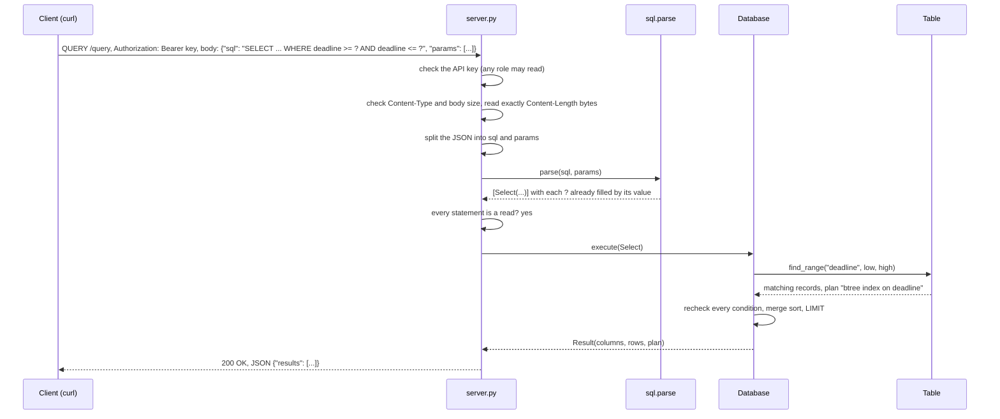
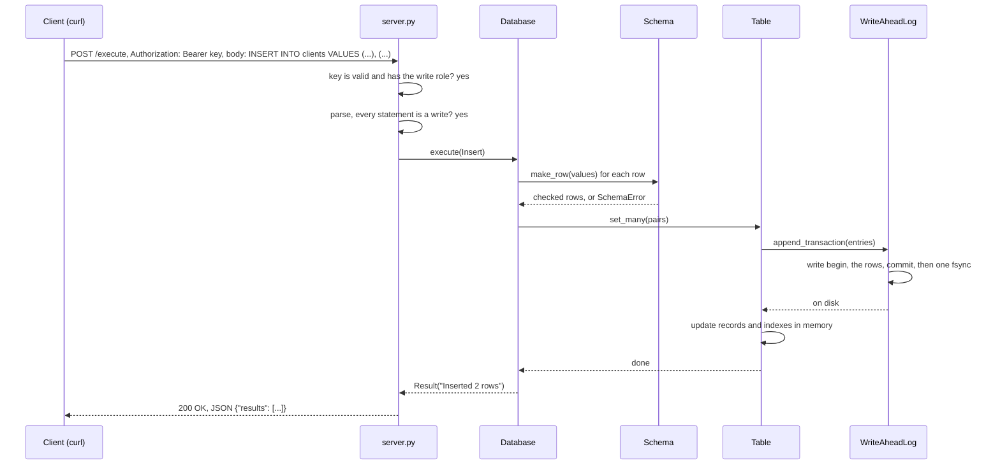

# tinydb architecture

| | |
|---|---|
| **Document** | Architecture and design |
| **Version** | 1.0 (Phase 7) |
| **Date** | 2026-11-20 |
| **Related** | [requirements.md](requirements.md), [api-spec.md](api-spec.md), [benchmarks.md](benchmarks.md), [design.md](design.md) |

This document explains **how** tinydb is built to meet its [requirements](requirements.md). The diagrams are written in Mermaid, which GitHub draws as pictures. Phase 5 designed the HTTP server and Phase 6 built it, along with API keys and encryption at rest. Phase 7 added parameterized queries, benchmarks and a demo, and fixed the two performance bugs the benchmarks found.

## 1. Layers

tinydb is built in layers. Each layer only calls the one below it, and nothing below the parsers knows where a request came from.



| Layer | Job | Knows nothing about |
|---|---|---|
| Tools (benchmarks, demo) | Build sample data, then measure or demonstrate the layers below through their normal entry points | Anything inside those layers |
| Interfaces (shell, server) | Read input, show output. The server also checks API keys and request limits. | How data is stored |
| Parsers | Turn text into statement objects | Data, files |
| Database | Check statements against schemas, pick a plan, run it, return a Result | Printing, HTTP |
| Table and indexes | Hold records in memory, find them fast | SQL |
| WriteAheadLog and Storage | Get changes safely onto disk, and back after a restart | What a record means |
| Cipher | Encrypt and seal each log line when the folder has a passphrase | Anything above Storage |

## 2. Main classes



- **Composition** (the filled diamond): a Database owns its Tables and Schemas, and a Table owns its Records and Indexes. When a table is dropped, they go with it.
- **Inheritance** (the hollow triangle): `HashIndex` and `BTreeIndex` share the `Index` base class. `WriteAheadLog` is a `Storage` that also understands transactions, so `Table` works with either one.
- **Dependency injection:** a Table is given its Storage instead of building one inside itself. Tests pass in a temporary file, and Phase 4 passed in a WriteAheadLog without changing how Table uses it.

## 3. Reading over HTTP

A `SELECT` sent with the HTTP `QUERY` method, as JSON with `?` placeholders. The server checks that every statement only reads **before** it runs any of them, because QUERY is a safe method ([RFC 10008](https://www.rfc-editor.org/rfc/rfc10008)). A plain `application/sql` body takes the same path with no values.



If any statement in the body would change data, the server answers `400` and runs nothing. See [api-spec.md](api-spec.md) for every status code.

## 4. Writing over HTTP

An `INSERT` of several rows, sent with `POST`. The write-ahead log makes the whole statement one transaction.



The order matters. Every row is checked before anything is written, and the log is on disk before memory changes. A crash at any point leaves either the whole statement or none of it.

## 5. Startup and crash recovery

Every log, the catalog and each table, is rebuilt the same way when the Database opens.


Replay rebuilds records **and** index contents. Only index definitions are logged, so an index can never disagree with the data.

## 6. Data on disk

```
tinydb.jsonl              key-value store used by the shell (--db)
tinydb_data/              SQL database (--dir)
    _catalog.jsonl        which tables exist, and each one's schema
    _keys.json            API keys: id, name, role and SHA-256 hash, never the key (mode 0600)
    _crypto.json          only if encrypted: salt, PBKDF2 rounds, and a check value
    clients.jsonl         one log per table
    plans.jsonl
    enrollment_periods.jsonl
```

```
_catalog.jsonl
{"op": "create_table", "table": "clients", "schema": {"columns": [...]}}

clients.jsonl
{"op": "begin", "tx": 1}
{"op": "set", "key": "1", "value": {"id": 1, "name": "Ada Reyes", "birth_date": "1956-03-14"}}
{"op": "set", "key": "2", "value": {"id": 2, "name": "Bob Okafor", "birth_date": "1959-11-02"}}
{"op": "commit", "tx": 1}
{"op": "index", "field": "zip", "kind": "hash"}
```

A row is a Record. Its key is the primary key as text, and its value is a dict of its columns. NULL columns are left out.

In an encrypted folder each of those lines is replaced by one base64 line: `version | nonce | ciphertext | tag`. The tag also covers the file's name, so a line can't be moved to another table's log.

## 7. Design decisions

| Decision | Why | Trade-off |
|---|---|---|
| Append-only JSON-lines log | A crash can't damage saved data. Easy to read and debug. | The log grows until compaction, and startup replays all of it. |
| Everything in memory | O(1) key lookups, simple code | Data must fit in RAM. |
| Hand-built hash table and B-tree | Learn how real indexes work | Slower than Python's built-in `dict` |
| Write-ahead log with begin and commit | Each statement is atomic | One extra fsync per statement |
| Parser separate from Database | The server can check a request before running it. Tests don't need files. | One more layer |
| Database returns Result, never prints | The shell and the server format the same Result their own way | None |
| QUERY for reads, POST for writes | The method tells clients and caches whether a request changes data. SQL fits in the body, not a URL. | Browsers can't send QUERY from forms yet, and some tools need `-X QUERY`. |
| `http.server`, one lock around the Database | No framework, as the constraints require. One lock keeps two requests from changing a table at once. | One request uses the database at a time. That's fine for a small server. |
| API keys stored as SHA-256 hashes, two roles | A copied keys file can't be used. Read keys only work with QUERY (least privilege). | Keys can't be shown again, only revoked and remade. |
| Encryption from HMAC-SHA256 (CTR + encrypt-then-MAC) | The standard library has no AES, and the project allows no packages. | Unreviewed code. Production should use AES-GCM from a vetted library. |
| Encryption in Storage only | One place to change. WAL, Table, indexes and SQL didn't change. | Line counts and sizes still show. File names stay readable. |
| `?` values filled in by the parser | A value goes straight into the parsed statement and never through the lexer, so it can't become SQL. The rest of the engine didn't change. | Placeholders only stand for values, not table or column names (the same rule as every real database). |
| JSON body for parameterized queries | Values keep their types (number, string, `true`, `null`) with no new encoding to invent. | Two body formats to accept and test. |
| Planner gives a B-tree both ends of a range | Found by the benchmark: with one end, a one-week range read most of the table. | None. The final check on every row still guarantees the right answer. |
| `TCP_NODELAY` on server sockets | Found by the benchmark: Nagle's algorithm plus delayed ACK added about 40 ms to every kept-alive request. | Slightly more small packets on the network. |
| Seeded sample data and a fixed demo date | Benchmarks and the demo give the same data and answers on every run and every machine. | The demo's "today" is a fixed date, said out loud. |

## 8. Server and security design (Phase 6)

- `server.py` has `do_QUERY`, `do_POST`, `do_OPTIONS` and `do_GET` methods on a `BaseHTTPRequestHandler`. `http.server` calls `do_<METHOD>` for whatever method arrives, so QUERY needs no special setup. All four go to one router, and every refusal is raised as an `ApiError` that becomes a JSON error.
- It runs on `ThreadingHTTPServer`, so a slow client doesn't block others while it sends its body. A single `threading.Lock` lets one request at a time use the Database.
- **Order of checks:** path, method, API key, role, headers, body. A stranger gets `401` before the server reads a byte of the body.
- **Limits:** 1 MB bodies, 100 statements per request, 10 seconds of silence per connection, 32 connections at once (more get `503`), 64-character names, 30-character numbers, 64-bit INTs, finite FLOATs.
- **The body must arrive whole.** If fewer than `Content-Length` bytes arrive, nothing runs, so a dropped connection can't turn `DELETE ... WHERE id = 5` into `DELETE FROM clients`.
- **API keys** (`auth.py`) are 256-bit random tokens. Only their SHA-256 hashes are stored. They're checked with `hmac.compare_digest` without stopping early, and the keys file is reread when it changes, so a revoked key stops working right away.
- **Encryption at rest** (`crypto.py`): PBKDF2 (600,000 rounds) turns the passphrase into an encryption key and a MAC key. Each line is XORed with an HMAC-SHA256 keystream and sealed with an HMAC tag. `Database` checks the passphrase against `_crypto.json` before any log is replayed, so recovery can never mistake a wrong passphrase for a torn write.
- **Known limits:** someone who can write the files can still drop the newest line (it looks torn), roll the folder back, or reorder lines within a file. Fixing that needs chained tags and a counter kept somewhere else.

## 9. Measuring and showing (Phase 7)

- **`sample.py`** generates made-up plans, clients and enrollment periods from a seed, with its own `random.Random`, so the same seed always gives the same rows. It loads 500 rows per `INSERT`, one transaction and one fsync each.
- **`bench.py`** times the engine through `Database.run` and the API through a real server, so every number includes parsing and planning. Each benchmark runs several times and reports the median. The garbage collector is paused while a run is timed, as `timeit` does. The results, and what they taught, are in [benchmarks.md](benchmarks.md).
- **`demo.py`** starts the real server on a free port with a read key and a write key in a temporary folder, and walks through 12 requests, printing each one and its answer. A test checks every status code it gets.
- **Two bugs found by measuring, not by tests.** The planner used one end of a range (fixed with `range_bounds`), and kept-alive HTTP requests waited about 40 ms each on Nagle's algorithm (fixed with `TCP_NODELAY`). Both answers were always correct, which is why 458 tests passed. Each fix now has a regression test.
