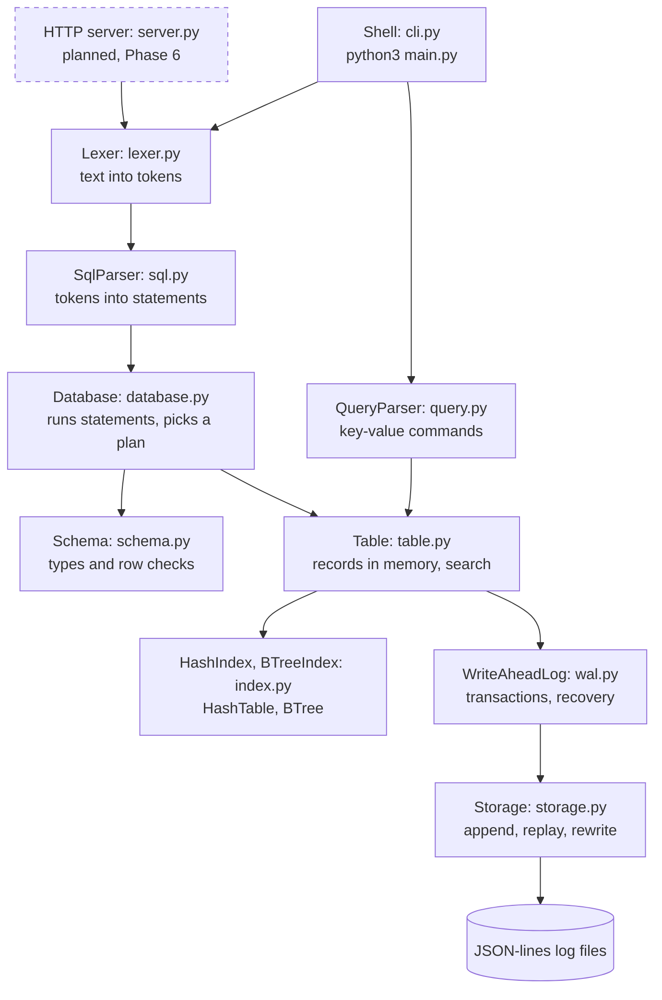
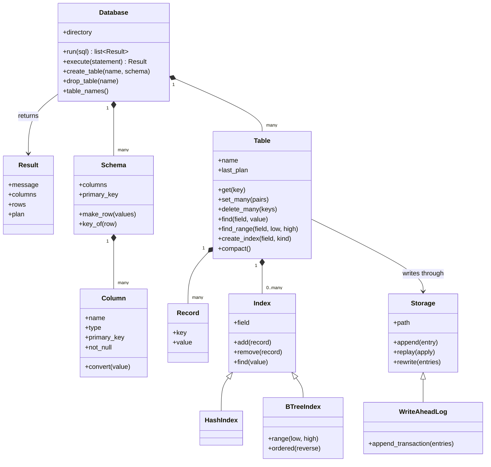
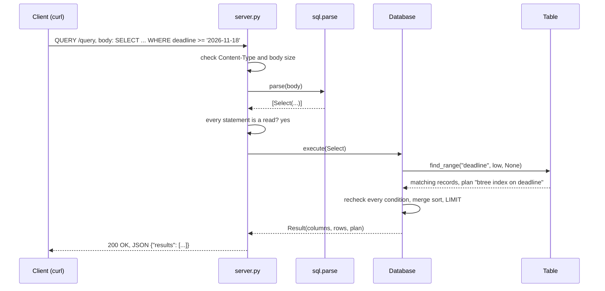
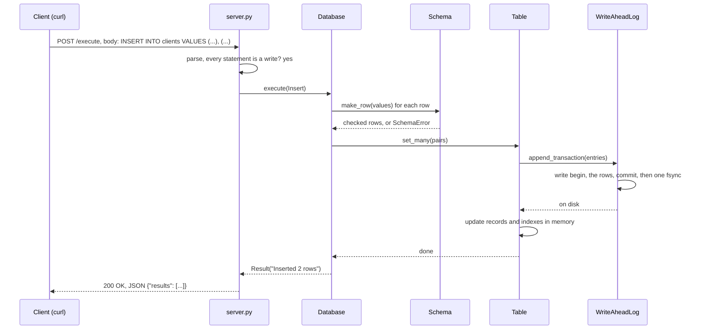
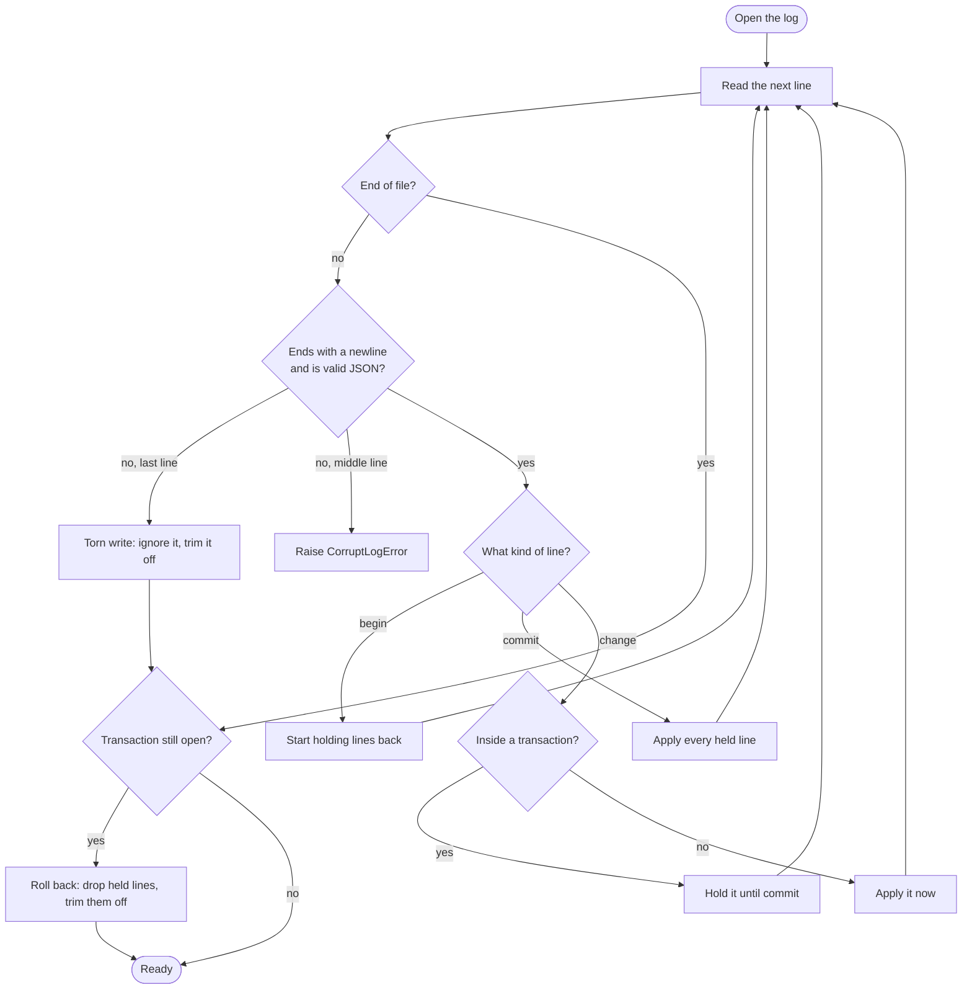

# tinydb architecture

| | |
|---|---|
| **Document** | Architecture and design |
| **Version** | 0.5 (Phase 5) |
| **Date** | 2026-11-18 |
| **Related** | [requirements.md](requirements.md), [api-spec.md](api-spec.md) |

This document explains **how** tinydb is built to meet its [requirements](requirements.md). The diagrams are written in Mermaid, which GitHub draws as pictures. Parts marked **planned** are designed here and built in Phase 6.

## 1. Layers

tinydb is built in layers. Each layer only calls the one below it, and nothing below the parsers knows where a request came from.



| Layer | Job | Knows nothing about |
|---|---|---|
| Interfaces (shell, server) | Read input, show output | How data is stored |
| Parsers | Turn text into statement objects | Data, files |
| Database | Check statements against schemas, pick a plan, run it, return a Result | Printing, HTTP |
| Table and indexes | Hold records in memory, find them fast | SQL |
| WriteAheadLog and Storage | Get changes safely onto disk, and back after a restart | What a record means |

## 2. Main classes



- **Composition** (the filled diamond): a Database owns its Tables and Schemas, and a Table owns its Records and Indexes. When a table is dropped, they go with it.
- **Inheritance** (the hollow triangle): `HashIndex` and `BTreeIndex` share the `Index` base class. `WriteAheadLog` is a `Storage` that also understands transactions, so `Table` works with either one.
- **Dependency injection:** a Table is given its Storage instead of building one inside itself. Tests pass in a temporary file, and Phase 4 passed in a WriteAheadLog without changing how Table uses it.

## 3. Reading over HTTP (planned)

A `SELECT` sent with the HTTP `QUERY` method. The server checks that every statement only reads **before** it runs any of them, because QUERY is a safe method ([RFC 10008](https://www.rfc-editor.org/rfc/rfc10008)).



If any statement in the body would change data, the server answers `400` and runs nothing. See [api-spec.md](api-spec.md) for every status code.

## 4. Writing over HTTP (planned)

An `INSERT` of several rows, sent with `POST`. The write-ahead log makes the whole statement one transaction.



The order matters. Every row is checked before anything is written, and the log is on disk before memory changes. A crash at any point leaves either the whole statement or none of it.

## 5. Startup and crash recovery

Every log, the catalog and each table, is rebuilt the same way when the Database opens.



Replay rebuilds records **and** index contents. Only index definitions are logged, so an index can never disagree with the data.

## 6. Data on disk

```
tinydb.jsonl              key-value store used by the shell (--db)
tinydb_data/              SQL database (--dir)
    _catalog.jsonl        which tables exist, and each one's schema
    clients.jsonl         one log per table
    plans.jsonl
    enrollment_periods.jsonl
```

```
_catalog.jsonl
{"op": "create_table", "table": "clients", "schema": {"columns": [...]}}

clients.jsonl
{"op": "begin", "tx": 1}
{"op": "set", "key": "1", "value": {"id": 1, "name": "Ada Reyes", "birth_date": "1956-03-14"}}
{"op": "set", "key": "2", "value": {"id": 2, "name": "Bob Okafor", "birth_date": "1959-11-02"}}
{"op": "commit", "tx": 1}
{"op": "index", "field": "zip", "kind": "hash"}
```

A row is a Record. Its key is the primary key as text, and its value is a dict of its columns. NULL columns are left out.

## 7. Design decisions

| Decision | Why | Trade-off |
|---|---|---|
| Append-only JSON-lines log | A crash can't damage saved data. Easy to read and debug. | The log grows until compaction, and startup replays all of it. |
| Everything in memory | O(1) key lookups, simple code | Data must fit in RAM. |
| Hand-built hash table and B-tree | Learn how real indexes work | Slower than Python's built-in `dict` |
| Write-ahead log with begin and commit | Each statement is atomic | One extra fsync per statement |
| Parser separate from Database | The server can check a request before running it. Tests don't need files. | One more layer |
| Database returns Result, never prints | The shell and the server format the same Result their own way | None |
| QUERY for reads, POST for writes | The method tells clients and caches whether a request changes data. SQL fits in the body, not a URL. | Browsers can't send QUERY from forms yet, and some tools need `-X QUERY`. |
| `http.server`, one lock around the Database | No framework, as the constraints require. One lock keeps two requests from changing a table at once. | One request uses the database at a time. That's fine for a small server. |

## 8. Planned server design (Phase 6)

- `server.py` adds a `do_QUERY`, `do_POST`, `do_OPTIONS` and `do_GET` method to a `BaseHTTPRequestHandler`. `http.server` calls `do_<METHOD>` for whatever method arrives, so QUERY needs no special setup.
- It runs on `ThreadingHTTPServer`, so a slow client doesn't block others while it sends its body. A single `threading.Lock` lets one request at a time use the Database.
- It listens on `127.0.0.1:8000` by default and rejects bodies over 1 MB.
- Phase 6 adds API keys, input checks and encryption at rest on top, without changing the layers below the server.
